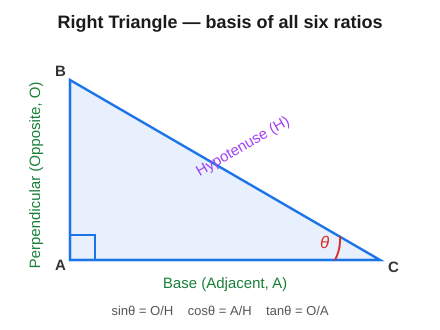
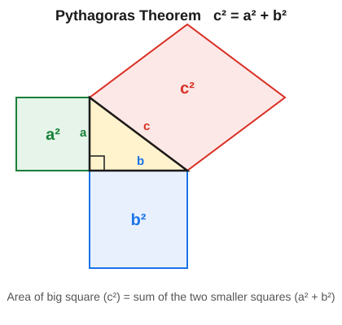
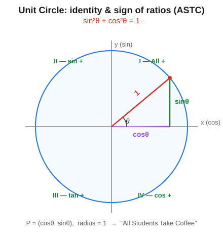
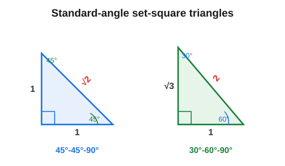
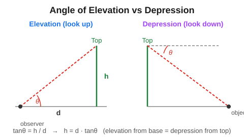

# 📐 SSC CGL Master Formula Handbook
## Arithmetic • Algebra • Trigonometry • Geometry Theorems • Mensuration • Probability • Statistics

> **A complete, exam-ready formula & theorem reference for competitive examinations.**
> For: SSC CGL • CHSL • CPO • MTS • RRB • Banking • State PSC

---

## 🎯 How to Use This Handbook

| Need | Go to |
|------|-------|
| Daily-use arithmetic shortcuts | Part 1 |
| Algebraic identities & equations | Part 2 |
| Trig ratios, values, identities | Part 3 |
| Geometry theorems & properties | Part 4 |
| Area / volume / surface area | Part 5 |
| Probability rules | Part 6 |
| Mean / median / SD | Part 7 |

> 🧠 **Legend:** 💡 Shortcut · ⚠️ Common Error · 📌 Exam Note · ⭐ Must-Memorise

**Golden principle:** *In SSC Quant, knowing the right formula instantly is half the battle; the other half is recognising which formula applies.* This book is organised so every formula sits next to the situation that triggers it.

---

# PART 1 — ARITHMETIC FORMULAS

## 1.1 Number System

| Concept | Formula |
|---------|---------|
| Sum of first n natural numbers | `1+2+…+n = n(n+1)/2` |
| Sum of first n odd numbers | `1+3+5+… = n²` |
| Sum of first n even numbers | `2+4+6+… = n(n+1)` |
| Sum of squares | `1²+2²+…+n² = n(n+1)(2n+1)/6` |
| Sum of cubes | `1³+2³+…+n³ = [n(n+1)/2]²` |
| Number of factors of N = a^p · b^q · c^r | `(p+1)(q+1)(r+1)` |
| Sum of factors | `[(a^(p+1)−1)/(a−1)]·[(b^(q+1)−1)/(b−1)]…` |
| Product of factors | `N^(no. of factors / 2)` |

⭐ **Divisibility rules:**
- **2:** last digit even · **3:** digit-sum ÷3 · **4:** last 2 digits ÷4 · **5:** ends 0/5
- **6:** ÷2 and ÷3 · **8:** last 3 digits ÷8 · **9:** digit-sum ÷9 · **11:** (odd-place sum − even-place sum) ÷11

## 1.2 HCF & LCM

| Rule | Formula |
|------|---------|
| Product relation | `HCF × LCM = Product of two numbers` |
| HCF of fractions | `HCF(numerators) / LCM(denominators)` |
| LCM of fractions | `LCM(numerators) / HCF(denominators)` |

## 1.3 Percentage

| Concept | Formula |
|---------|---------|
| x% of y | `(x/100)·y` |
| Increase % | `[(New−Old)/Old]·100` |
| Decrease % | `[(Old−New)/Old]·100` |
| Successive change a%, b% | `a + b + (ab/100)` |
| If A is x% more than B, B is less than A by | `[x/(100+x)]·100 %` |
| If A is x% less than B, B is more than A by | `[x/(100−x)]·100 %` |

💡 **Fraction ⇄ %:** 1/2=50%, 1/3=33⅓%, 1/4=25%, 1/5=20%, 1/6=16⅔%, 1/7=14²⁄₇%, 1/8=12½%, 1/9=11⅑%, 1/11=9¹⁄₁₁%, 1/12=8⅓%.

## 1.4 Profit, Loss & Discount

| Concept | Formula |
|---------|---------|
| Profit | `SP − CP` |
| Loss | `CP − SP` |
| Profit % | `(Profit/CP)·100` |
| Loss % | `(Loss/CP)·100` |
| SP from CP | `CP·(100+P%)/100` |
| CP from SP | `SP·100/(100+P%)` |
| Discount | `MP − SP` |
| Discount % | `(Discount/MP)·100` |
| Two successive discounts a%, b% | `a + b − (ab/100)` |
| Marked-up by m%, discount d% net | `m − d − (md/100)` |

⚠️ **Trap:** Selling two items at same SP, one at +x% one at −x% → **always a net loss** of `(x/10)²%`.

## 1.5 Simple & Compound Interest

| Type | Formula |
|------|---------|
| Simple Interest | `SI = PRT/100` |
| Amount (SI) | `A = P(1 + RT/100)` |
| Compound Interest | `A = P(1 + R/100)ⁿ`, `CI = A − P` |
| CI (half-yearly) | `A = P(1 + R/200)^(2n)` |
| CI (quarterly) | `A = P(1 + R/400)^(4n)` |
| Difference CI−SI (2 yrs) | `P(R/100)²` |
| Difference CI−SI (3 yrs) | `P(R/100)²·(3 + R/100)` |

💡 If a sum doubles in `t` years at SI, rate = `100/t %`.

## 1.6 Ratio & Proportion

| Concept | Formula |
|---------|---------|
| Proportion | `a:b = c:d ⇒ ad = bc` |
| Mean proportional of a,b | `√(ab)` |
| Third proportional of a,b | `b²/a` |
| Fourth proportional of a,b,c | `bc/a` |
| Componendo-dividendo | `if a/b=c/d ⇒ (a+b)/(a−b)=(c+d)/(c−d)` |

## 1.7 Average

| Concept | Formula |
|---------|---------|
| Average | `Sum of items / Number of items` |
| Avg speed (equal distance) | `2xy/(x+y)` |
| Avg of first n natural nos. | `(n+1)/2` |
| Avg of consecutive numbers | `(first + last)/2` |

## 1.8 Time & Work

| Concept | Formula |
|---------|---------|
| Work rate | `1 day's work = 1/Total days` |
| A,B together | `1/A + 1/B = 1/T ⇒ T = AB/(A+B)` |
| Efficiency ratio | inversely proportional to time |
| M₁D₁H₁/W₁ = M₂D₂H₂/W₂ | work-equivalence formula |
| Pipes: fill+empty | `1/fill − 1/empty` (net rate) |

## 1.9 Time, Speed & Distance

| Concept | Formula |
|---------|---------|
| Speed | `Distance / Time` |
| km/h → m/s | `× 5/18` |
| m/s → km/h | `× 18/5` |
| Train passing pole | `time = length/speed` |
| Train passing platform | `time = (L_train + L_platform)/speed` |
| Relative speed (same dir) | `s₁ − s₂` |
| Relative speed (opp dir) | `s₁ + s₂` |
| Boat downstream | `(b + s)` |
| Boat upstream | `(b − s)` |
| Boat speed | `½(down + up)`; Stream `½(down − up)` |

## 1.10 Mixtures & Alligation

| Concept | Formula |
|---------|---------|
| Alligation rule | `(Cheaper qty)/(Dearer qty) = (D − Mean)/(Mean − C)` |
| Repeated replacement | `Final = Initial·(1 − x/V)ⁿ` |

## 1.11 Problems on Ages
- If present age = x, then `n years ago = x−n`, `n years hence = x+n`.
- Ratio method: assign `kx, ky` and use the time condition.

---

# PART 2 — ALGEBRAIC FORMULAS

## 2.1 ⭐ Basic Identities (memorise cold)

| Identity | Formula |
|----------|---------|
| Square of sum | `(a+b)² = a² + 2ab + b²` |
| Square of difference | `(a−b)² = a² − 2ab + b²` |
| Difference of squares | `a² − b² = (a+b)(a−b)` |
| Sum of squares | `a² + b² = (a+b)² − 2ab = (a−b)² + 2ab` |
| Three-term square | `(a+b+c)² = a²+b²+c² + 2(ab+bc+ca)` |
| Cube of sum | `(a+b)³ = a³ + b³ + 3ab(a+b)` |
| Cube of difference | `(a−b)³ = a³ − b³ − 3ab(a−b)` |
| Sum of cubes | `a³ + b³ = (a+b)(a²−ab+b²)` |
| Difference of cubes | `a³ − b³ = (a−b)(a²+ab+b²)` |
| Three-cube identity | `a³+b³+c³−3abc = (a+b+c)(a²+b²+c²−ab−bc−ca)` |
| Special case | `if a+b+c=0 ⇒ a³+b³+c³ = 3abc` |

## 2.2 ⭐ Frequently-Tested Derived Results

| Given | Result |
|-------|--------|
| `x + 1/x = a` | `x² + 1/x² = a² − 2` |
| `x − 1/x = a` | `x² + 1/x² = a² + 2` |
| `x + 1/x = a` | `x³ + 1/x³ = a³ − 3a` |
| `x − 1/x = a` | `x³ − 1/x³ = a³ + 3a` |
| `x + 1/x = a` | `x⁴ + 1/x⁴ = (a²−2)² − 2` |

💡 These "x + 1/x" results are SSC favourites — they appear almost every shift.

## 2.3 Indices (Laws of Exponents)

| Law | Formula |
|-----|---------|
| Product | `aᵐ · aⁿ = aᵐ⁺ⁿ` |
| Quotient | `aᵐ / aⁿ = aᵐ⁻ⁿ` |
| Power of power | `(aᵐ)ⁿ = aᵐⁿ` |
| Power of product | `(ab)ⁿ = aⁿbⁿ` |
| Zero power | `a⁰ = 1 (a≠0)` |
| Negative power | `a⁻ⁿ = 1/aⁿ` |
| Fractional | `a^(m/n) = ⁿ√(aᵐ)` |

## 2.4 Surds

| Rule | Formula |
|------|---------|
| Product | `√a · √b = √(ab)` |
| Quotient | `√a / √b = √(a/b)` |
| Rationalising | `1/(√a+√b) × (√a−√b)/(√a−√b)` |
| Conjugate | of `a+√b` is `a−√b` |

## 2.5 Quadratic Equations `ax² + bx + c = 0`

| Concept | Formula |
|---------|---------|
| Roots (quadratic formula) | `x = [−b ± √(b²−4ac)] / 2a` |
| Discriminant | `D = b² − 4ac` |
| D > 0 | real & distinct roots |
| D = 0 | real & equal roots |
| D < 0 | complex roots |
| Sum of roots | `α + β = −b/a` |
| Product of roots | `αβ = c/a` |
| Form equation from roots | `x² − (α+β)x + αβ = 0` |

## 2.6 Progressions

**Arithmetic Progression (AP):**
| Concept | Formula |
|---------|---------|
| nth term | `aₙ = a + (n−1)d` |
| Sum of n terms | `Sₙ = (n/2)[2a + (n−1)d]` |
| Sum (first & last) | `Sₙ = (n/2)(a + l)` |

**Geometric Progression (GP):**
| Concept | Formula |
|---------|---------|
| nth term | `aₙ = a·r^(n−1)` |
| Sum of n terms | `Sₙ = a(rⁿ−1)/(r−1)` (r≠1) |
| Sum to infinity | `S∞ = a/(1−r)`, `|r|<1` |
| Geometric mean of a,b | `√(ab)` |

## 2.7 Polynomial Remainder/Factor

- **Remainder theorem:** dividing `f(x)` by `(x−a)` gives remainder `f(a)`.
- **Factor theorem:** `(x−a)` is a factor ⇔ `f(a) = 0`.

---

# PART 3 — TRIGONOMETRY

## 3.0 🖼️ Pictorial Representation of Trigonometric Theorems

*(Diagrams are scalable SVG — they stay crisp when zoomed in Chrome and resize cleanly on the GitHub mobile app.)*

### (i) The Right Triangle — basis of all six ratios

<p align="center"></p>

Every ratio is just a **side ratio** of this triangle:
`sinθ = O/H`, `cosθ = A/H`, `tanθ = O/A` (and their reciprocals cosec, sec, cot).

### (ii) Pythagoras Theorem — `c² = a² + b²`

<p align="center"></p>

The square drawn on the hypotenuse has area equal to the **sum** of the squares on the other two sides.

### (iii) Fundamental Identity — `sin²θ + cos²θ = 1`

Divide Pythagoras `a² + b² = c²` (i.e. `O² + A² = H²`) throughout by `H²`:

```
   O²/H² + A²/H² = 1   ⇒   sin²θ + cos²θ = 1
   ÷ A²  ⇒  1 + tan²θ = sec²θ
   ÷ O²  ⇒  1 + cot²θ = cosec²θ
```

This is also visible in the unit circle below, where the legs are `sinθ` and `cosθ` and the radius (hypotenuse) is `1`.

### (iv) Unit Circle — identity & sign of ratios (ASTC)

<p align="center"></p>

A point on the unit circle is `P = (cosθ, sinθ)`. The four quadrants follow **A-S-T-C** ("All Students Take Coffee") for which ratios are positive.

### (v) Standard Angles — the 45-45-90 and 30-60-90 set-squares

<p align="center"></p>

These two triangles generate the whole standard-values table: `sin45 = 1/√2`; `sin30 = 1/2`, `cos30 = √3/2`, etc.

### (vi) Angle of Elevation vs Depression (Heights & Distances)

<p align="center"></p>

`tanθ = h / d ⇒ h = d·tanθ`. The angle of elevation from the base equals the angle of depression from the top (alternate angles).

> 💡 **Reading the pictures:** every trig ratio is just a *side ratio* of picture (i); every identity is picture (ii) divided through; the unit circle (iv) tells you the **sign**; pictures (v)–(vi) are the two situations SSC tests most.

---

## 3.1 ⭐ The Six Ratios (right triangle)

For angle θ with **Opposite (O)**, **Adjacent (A)**, **Hypotenuse (H)**:

| Ratio | Definition | Reciprocal |
|-------|-----------|------------|
| sin θ | O/H | cosec θ = H/O |
| cos θ | A/H | sec θ = H/A |
| tan θ | O/A | cot θ = A/O |

`tan θ = sin θ / cos θ`,  `cot θ = cos θ / sin θ`

## 3.2 ⭐ Standard Values Table

| θ | 0° | 30° | 45° | 60° | 90° |
|---|----|----|----|----|----|
| **sin** | 0 | 1/2 | 1/√2 | √3/2 | 1 |
| **cos** | 1 | √3/2 | 1/√2 | 1/2 | 0 |
| **tan** | 0 | 1/√3 | 1 | √3 | ∞ |
| **cosec** | ∞ | 2 | √2 | 2/√3 | 1 |
| **sec** | 1 | 2/√3 | √2 | 2 | ∞ |
| **cot** | ∞ | √3 | 1 | 1/√3 | 0 |

💡 **Memory trick (sin):** `√0/2, √1/2, √2/2, √3/2, √4/2` for 0°,30°,45°,60°,90°. cos is the reverse order.

## 3.3 ⭐ Fundamental Identities

| Identity |
|----------|
| `sin²θ + cos²θ = 1` |
| `1 + tan²θ = sec²θ` |
| `1 + cot²θ = cosec²θ` |

## 3.4 Complementary Angles (90° − θ)

| `sin(90−θ) = cos θ` | `cos(90−θ) = sin θ` |
|---|---|
| `tan(90−θ) = cot θ` | `cot(90−θ) = tan θ` |
| `sec(90−θ) = cosec θ` | `cosec(90−θ) = sec θ` |

## 3.5 Sign of Ratios (ASTC — "All Students Take Coffee")

| Quadrant | Positive ratios |
|----------|-----------------|
| I (0–90°) | **A**ll |
| II (90–180°) | **S**in (& cosec) |
| III (180–270°) | **T**an (& cot) |
| IV (270–360°) | **C**os (& sec) |

## 3.6 Sum & Difference Formulas

| Formula |
|---------|
| `sin(A±B) = sinA cosB ± cosA sinB` |
| `cos(A±B) = cosA cosB ∓ sinA sinB` |
| `tan(A±B) = (tanA ± tanB)/(1 ∓ tanA tanB)` |

## 3.7 Double / Multiple Angle

| Formula |
|---------|
| `sin2θ = 2 sinθ cosθ` |
| `cos2θ = cos²θ − sin²θ = 2cos²θ − 1 = 1 − 2sin²θ` |
| `tan2θ = 2tanθ/(1 − tan²θ)` |
| `sin3θ = 3sinθ − 4sin³θ` |
| `cos3θ = 4cos³θ − 3cosθ` |

## 3.8 Heights & Distances

| Term | Meaning |
|------|---------|
| Angle of elevation | looking **up** from horizontal |
| Angle of depression | looking **down** from horizontal |

💡 Standard results (height h, distance d):
- `tan θ = h/d` ⇒ `h = d·tan θ`
- At 45°, height = base distance.
- At 30° vs 60° from two points distance `d` apart: `h = d·(√3/2)`... use `h = d / (cotθ₁ − cotθ₂)` set-up.

## 3.9 Range of Values
- `−1 ≤ sinθ, cosθ ≤ 1`
- `secθ, cosecθ ≥ 1 or ≤ −1`
- `tanθ, cotθ ∈ (−∞, ∞)`

---

# PART 4 — GEOMETRY: THEOREMS & PROPERTIES

## 4.1 Lines & Angles
- Angles on a straight line sum to **180°** (linear pair).
- Angles around a point sum to **360°**.
- Vertically opposite angles are **equal**.
- Parallel lines cut by a transversal: corresponding angles equal, alternate angles equal, co-interior (allied) angles sum to **180°**.

## 4.2 Triangles — Core Properties
- Angle sum = **180°**; exterior angle = sum of two opposite interior angles.
- Sum of any two sides > third side (triangle inequality).
- Side opposite the larger angle is longer.

| Centre | Definition | Key fact |
|--------|-----------|----------|
| **Centroid** | intersection of medians | divides each median **2:1** |
| **Incentre** | intersection of angle bisectors | centre of inscribed circle |
| **Circumcentre** | intersection of perpendicular bisectors | centre of circumscribed circle |
| **Orthocentre** | intersection of altitudes | — |

## 4.3 ⭐ Pythagoras Theorem
For a right triangle: `Hypotenuse² = Base² + Perpendicular²`
- Converse: if `a² + b² = c²`, the triangle is right-angled.
- Common triples: **(3,4,5), (5,12,13), (8,15,17), (7,24,25), (9,40,41), (20,21,29)** and their multiples.

## 4.4 Congruence & Similarity
- **Congruence rules:** SSS, SAS, ASA, AAS, RHS → triangles identical.
- **Similarity rules:** AA, SSS (proportional), SAS (proportional).

| Similar triangles | Ratio |
|-------------------|-------|
| Corresponding sides | `a₁/a₂ = k` |
| Ratio of perimeters | `= k` |
| Ratio of areas | `= k²` |

- **Basic Proportionality (Thales) Theorem:** a line parallel to one side divides the other two sides proportionally.
- **Mid-point theorem:** segment joining midpoints of two sides is parallel to and half the third side.

## 4.5 Triangle Area Formulas

| Triangle | Area |
|----------|------|
| General (base, height) | `½ · b · h` |
| Heron's (sides a,b,c) | `√[s(s−a)(s−b)(s−c)]`, `s = (a+b+c)/2` |
| Equilateral (side a) | `(√3/4)·a²` |
| Right (legs p,b) | `½·p·b` |
| Two sides & included angle | `½·a·b·sinC` |

Equilateral side a: height `= (√3/2)a`, inradius `= a/(2√3)`, circumradius `= a/√3`.

## 4.6 ⭐ Circle Theorems
- Angle at centre = **2 ×** angle at circumference (same arc).
- Angle in a **semicircle = 90°**.
- Angles in the **same segment are equal**.
- **Cyclic quadrilateral:** opposite angles sum to **180°**.
- **Tangent** is perpendicular to the radius at point of contact.
- Tangents from an external point are **equal** in length.
- **Alternate segment theorem:** angle between tangent and chord = angle in alternate segment.

| Circle measure | Formula |
|----------------|---------|
| Tangent length (external pt, dist d, radius r) | `√(d² − r²)` |
| Two intersecting chords | `PA·PB = PC·PD` |
| Secant–secant | `PA·PB = PC·PD` |
| Length of common chord, etc. | use perpendicular from centre bisects chord |

## 4.7 Polygons
- Sum of interior angles of n-gon = `(n−2)·180°`.
- Each interior angle (regular) = `(n−2)·180°/n`.
- Sum of exterior angles = **360°** (any convex polygon).
- Each exterior angle (regular) = `360°/n`.
- Number of diagonals = `n(n−3)/2`.

## 4.8 Quadrilateral Properties (quick)
| Shape | Key property |
|-------|--------------|
| Parallelogram | opposite sides & angles equal; diagonals bisect |
| Rectangle | diagonals equal & bisect |
| Rhombus | diagonals bisect at 90° |
| Square | all of rectangle + rhombus |
| Trapezium | one pair parallel |

---

# PART 5 — MENSURATION

## 5.1 ⭐ 2D Figures — Area & Perimeter

| Figure | Area | Perimeter |
|--------|------|-----------|
| Square (side a) | `a²` | `4a`; diagonal `a√2` |
| Rectangle (l, b) | `l·b` | `2(l+b)`; diagonal `√(l²+b²)` |
| Triangle (b, h) | `½·b·h` | `a+b+c` |
| Equilateral (a) | `(√3/4)a²` | `3a` |
| Parallelogram | `base·height` | `2(a+b)` |
| Rhombus (diagonals d₁,d₂) | `½·d₁·d₂` | `4·side`, side `= ½√(d₁²+d₂²)` |
| Trapezium (parallel a,b; ht h) | `½(a+b)·h` | sum of sides |
| Circle (r) | `πr²` | circumference `2πr` |
| Semicircle | `½πr²` | `πr + 2r` |
| Sector (angle θ°, r) | `(θ/360)·πr²` | arc `= (θ/360)·2πr` |
| Ring/annulus (R, r) | `π(R² − r²)` | — |

## 5.2 ⭐ 3D Solids — Volume, Surface Area

| Solid | Volume | Curved/Lateral SA | Total SA |
|-------|--------|-------------------|----------|
| Cube (a) | `a³` | `4a²` | `6a²`; diagonal `a√3` |
| Cuboid (l,b,h) | `l·b·h` | `2h(l+b)` | `2(lb+bh+hl)`; diagonal `√(l²+b²+h²)` |
| Cylinder (r,h) | `πr²h` | `2πrh` | `2πr(r+h)` |
| Cone (r,h) | `⅓πr²h` | `πrl` | `πr(r+l)`; slant `l=√(r²+h²)` |
| Sphere (r) | `(4/3)πr³` | — | `4πr²` |
| Hemisphere (r) | `(2/3)πr³` | `2πr²` | `3πr²` |
| Frustum (R,r,h) | `⅓πh(R²+r²+Rr)` | `πl(R+r)` | `π[l(R+r)+R²+r²]`; `l=√(h²+(R−r)²)` |
| Prism | `Base area × height` | `perimeter × height` | LSA + 2·base |
| Pyramid | `⅓·Base area·height` | `½·perimeter·slant` | LSA + base |

💡 **Sphere quick facts:** Surface area of sphere = 4 × area of its great circle. A hemisphere's total SA = 3πr² (curved 2πr² + flat circle πr²).

## 5.3 Useful Mensuration Shortcuts
- **Cube painted & cut into n³ small cubes:** corner cubes (3 faces) = 8; edge (2 faces) = 12(n−2); face (1 face) = 6(n−2)²; inner (0 faces) = (n−2)³.
- **Largest sphere in cube (side a):** radius = a/2.
- **Largest cube in sphere (radius r):** side = 2r/√3.
- **Volume of water/displacement:** rise in level × base area = submerged volume.

---

# PART 6 — PROBABILITY (BASICS)

## 6.1 ⭐ Fundamental Definition
`P(E) = (Number of favourable outcomes) / (Total number of outcomes)`
- Always `0 ≤ P(E) ≤ 1`.
- `P(certain event) = 1`, `P(impossible event) = 0`.
- `P(not E) = 1 − P(E)` (complement rule).

## 6.2 Counting (Permutations & Combinations)

| Concept | Formula |
|---------|---------|
| Factorial | `n! = n·(n−1)·…·2·1`, `0! = 1` |
| Permutations (order matters) | `ⁿPᵣ = n!/(n−r)!` |
| Combinations (order doesn't) | `ⁿCᵣ = n!/[r!(n−r)!]` |
| Property | `ⁿCᵣ = ⁿC₍ₙ₋ᵣ₎` |
| Property | `ⁿC₀ = ⁿCₙ = 1` |

## 6.3 Addition & Multiplication Rules

| Rule | Formula |
|------|---------|
| Either/or (general) | `P(A∪B) = P(A) + P(B) − P(A∩B)` |
| Mutually exclusive | `P(A∪B) = P(A) + P(B)` (since A∩B = 0) |
| Independent events | `P(A∩B) = P(A)·P(B)` |
| Conditional probability | `P(A|B) = P(A∩B)/P(B)` |

## 6.4 ⭐ Standard Sample Spaces

| Experiment | Total outcomes |
|------------|----------------|
| One coin | 2 (H, T) |
| Two coins | 4 |
| n coins | 2ⁿ |
| One die | 6 |
| Two dice | 36 |
| Deck of cards | 52 (26 red, 26 black, 13 each suit, 12 face, 4 aces) |

💡 **Two dice quick facts:** P(sum=7) = 6/36 = 1/6 (most likely sum). P(doublet) = 6/36 = 1/6.

## 6.5 Worked Examples
- **One die, P(even)** = 3/6 = **1/2**.
- **Two coins, P(at least one head)** = 1 − P(no head) = 1 − 1/4 = **3/4**.
- **One card, P(king)** = 4/52 = **1/13**.
- **Two dice, P(sum = 9)** = 4/36 = **1/9** (combinations: 3-6,4-5,5-4,6-3).

---

# PART 7 — STATISTICS (BASICS)

## 7.1 ⭐ Measures of Central Tendency

| Measure | Formula |
|---------|---------|
| **Mean** (ungrouped) | `x̄ = Σx / n` |
| Mean (grouped) | `x̄ = Σ(f·x) / Σf` |
| **Median** (odd n, sorted) | value at `(n+1)/2` th position |
| Median (even n) | average of `n/2` and `(n/2 +1)` th values |
| **Mode** | most frequently occurring value |
| Empirical relation | `Mode = 3·Median − 2·Mean` |

## 7.2 Measures of Dispersion

| Measure | Formula |
|---------|---------|
| Range | `Max − Min` |
| Mean deviation (about mean) | `Σ|x − x̄| / n` |
| **Variance** (σ²) | `Σ(x − x̄)² / n` |
| **Standard Deviation** (σ) | `√Variance = √[Σ(x − x̄)²/n]` |
| SD (alternate) | `√[(Σx²/n) − x̄²]` |
| Coefficient of variation | `(σ / x̄) × 100 %` |

## 7.3 Quartiles & More
- **Q1** (lower quartile) = value at `(n+1)/4`; **Q3** at `3(n+1)/4`.
- **Interquartile range** = `Q3 − Q1`.
- **Median = Q2**.

## 7.4 Key Properties (exam-useful)
- Mean is affected by every value (sensitive to outliers); median is not.
- If each value is increased by `k`, mean & median increase by `k`, but **SD/variance stay the same**.
- If each value is multiplied by `k`, mean & SD multiply by `k`, variance by `k²`.
- For **first n natural numbers:** Mean = `(n+1)/2`; Variance = `(n²−1)/12`.

## 7.5 Worked Examples
- **Data 2,4,6,8,10:** Mean = 30/5 = **6**; Median = **6**; Range = 8; Variance = (16+4+0+4+16)/5 = 8 ⇒ SD = **√8 ≈ 2.83**.
- **Data 5,5,6,7,7,7,9:** Mode = **7**; Median = **7**; Mean = 46/7 ≈ 6.57.

---

# 🏁 FINAL QUICK-REVISION CAPSULE

## Must-Memorise Constants & Tables
- **π ≈ 22/7 ≈ 3.14** · **√2 ≈ 1.414** · **√3 ≈ 1.732** · **√5 ≈ 2.236**
- Squares 1–30, Cubes 1–15, Primes < 100, Pythagorean triples.
- Trig values table (0°–90°) and the three Pythagorean identities.

## The Identity Power-Five (used everywhere)
1. `(a±b)² = a² ± 2ab + b²`
2. `a² − b² = (a+b)(a−b)`
3. `(a+b)³ = a³+b³+3ab(a+b)`
4. `a³ ± b³ = (a±b)(a²∓ab+b²)`
5. `a+b+c=0 ⇒ a³+b³+c³ = 3abc`

## Cross-Topic Speed Rules
- Successive % change: `a + b + ab/100` (discount: `a + b − ab/100`).
- CI−SI (2 yr) = `P(R/100)²`.
- Average speed (equal distance) = `2xy/(x+y)`.
- Boat: speed = ½(down+up), stream = ½(down−up).
- Area ratio of similar figures = (side ratio)².
- Mode = 3·Median − 2·Mean.

---

> 📖 *End of Formula Handbook. Revise one Part per day, then test recall by covering the right-hand column of each table. A formula you can reproduce in under 3 seconds is one you actually own.*

**— Standalone SSC CGL Quantitative formula & theorem reference.**
