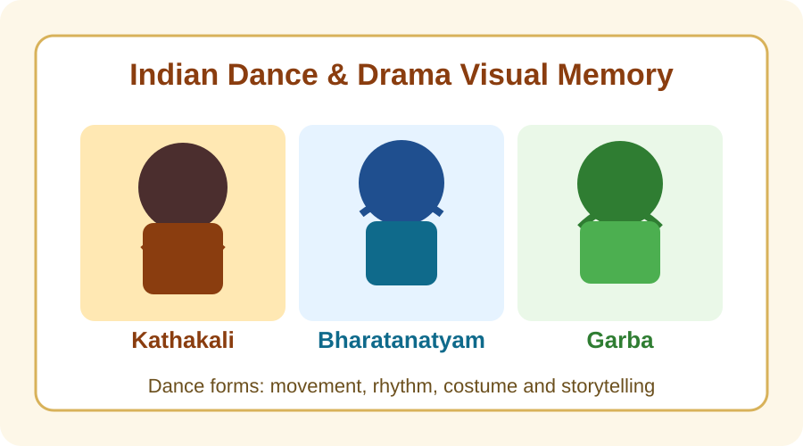
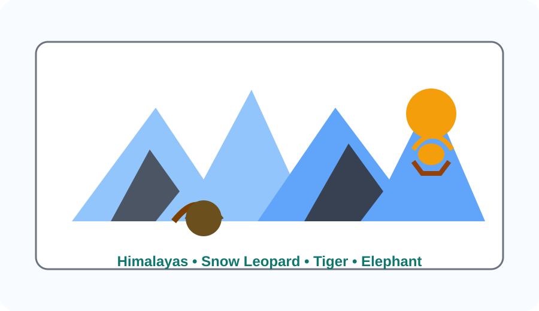

# Indian States, Major Festivals, Dances, Drama Forms, Crops, Summits, Appointments, Scientific Reports and International Rankings

## 1. Overview

India is known for its diversity in culture, food, festivals, dance forms, theatre traditions and agriculture. Every state has its own identity, celebrated through festivals, folk performance forms, local traditions, major crops and important public events. This updated note also includes major summits, appointments, scientific reports, research data, international rankings and medal-winning achievements for quick revision.

## 2. States and Their Major Festivals, Dances, Drama Forms and Crops

| State/UT          | Major Festivals                                                                   | Dance Forms                                                                  | Drama/Theatre Forms                                                  | Crop / India Significance                                                           | Cultural Note                                          |
| ----------------- | --------------------------------------------------------------------------------- | ---------------------------------------------------------------------------- | -------------------------------------------------------------------- | ----------------------------------------------------------------------------------- | ------------------------------------------------------ |
| Andhra Pradesh    | Ugadi; Sankranti; Tirumala Brahmotsavam; Varalakshmi Vratham; Krishna Janmashtami | Kuchipudi; Vilasini Natyam; Dappu; Kolatam; Bhamakalapam                     | Burrakatha; Veeragase; village street theatre                        | Rice and tobacco; Andhra is a leading producer of tobacco, mango and rice           | Famous for Tirumala and Kuchipudi traditions           |
| Arunachal Pradesh | Losar; Solung; Dree; Mopin; Boori-Boot                                            | Bardo Chham; Aji Lamu; Pasi Kongki; folk masks and group dances              | Tribal masked theatre; ritual storytelling; community performance    | Rice; maize; millet; important for hill agriculture and millet-based food           | Rich in tribal culture and mountain festivals          |
| Assam             | Bihu; Ambubachi Mela; Durga Puja; Kati Bihu; Bohag Bihu                           | Bihu dance; Sattriya; Bagurumba; Satriya-style movement                      | Bhaona; Ankia Naat; satra-based drama                                | Tea; rice; jute; Assam is India’s leading tea-producing state                       | Rongali Bihu is the most important spring festival     |
| Bihar             | Chhath Puja; Holi; Sama Chakeva; Kajri; Sohrai                                    | Jat-Jatin; Bidesia; Kajri dance; Domkach                                     | Folk drama; village storytelling; natak and local stage forms        | Makhana; rice; maize; Bihar is the largest producer of makhana in India             | Chhath Puja and the Ganga belt are central to identity |
| Chhattisgarh      | Bastar Dussehra; Madai; Pola; Hareli; Deepawali in tribal areas                   | Panthi; Raut Nacha; Gaur Maria dance; Karma dance                            | Tribal theatre; ritual performance; village dramatic forms           | Rice; millets; pulses; major paddy-growing region                                   | Bastar Dussehra is world-famous                        |
| Goa               | Carnival; Shigmo; Christmas; Sao Joao; Feast of St. Francis Xavier                | Fugdi; Dhalo; Dekhni; Kunbi dance                                            | Goan folk theatre; village stage performances; Christian pageants    | Coconut; cashew; rice; Goa is known for cashew and coconut farming                  | Carnival is the most celebrated event                  |
| Gujarat           | Navratri; Janmashtami; Rann Utsav; Uttarayan; Modhera fair                        | Garba; Dandiya; Tippani; Bhavai dance; Ghoomar (in some regions)             | Bhavai; folk stage drama; Rasdhara and local theatre                 | Groundnut; cotton; tobacco; Gujarat is a major producer of groundnut and cotton     | Garba is a major cultural identity                     |
| Haryana           | Teej; Baisakhi; Surajkund Mela; Gangore; Karwa Chauth                             | Khoria; Jhumar; Dhamal; folk circle dance                                    | Rural theatrical forms; folk drama; village performance              | Wheat; mustard; bajra; Haryana is a major wheat and mustard state                   | Surajkund Mela draws visitors from across India        |
| Himachal Pradesh  | Kullu Dussehra; Losar; Shivratri; Fagli; Minjar                                   | Nati; Dangi; Jataru; folk mask dances                                        | Folk theatre; local devotional drama; village performance traditions | Apple; wheat; barley; Himachal is famous for apple cultivation                      | Kullu Dussehra is very famous                          |
| Jharkhand         | Sarhul; Karma; Tusu Parab; Rohini; Baha Parab                                     | Chhau; Jhumar; Mundari dance; folk circle dances                             | Chhau performance; tribal theatre; ritual drama                      | Rice; maize; pulses; Jharkhand is important for paddy and minor millets             | Sarhul marks the beginning of the agricultural season  |
| Karnataka         | Ugadi; Mysuru Dasara; Pongal; Karaga; Kambala                                     | Yakshagana; Dollu Kunitha; Veeragase; Bayalata; Kamsale                      | Yakshagana; Bayalata; folk street theatre                            | Coffee; ragi; sugarcane; Karnataka is a major coffee-growing state                  | Mysuru Dasara is a grand royal celebration             |
| Kerala            | Onam; Vishu; Thrissur Pooram; Arattu; Theyyam season                              | Kathakali; Mohiniyattam; Theyyam; Koodiyattam movement                       | Kathakali; Koothu; Koodiyattam; temple-based drama                   | Rubber; coconut; spices; Kerala is a leading producer of rubber and spices          | Thrissur Pooram is a spectacular temple festival       |
| Madhya Pradesh    | Navratri; Khajuraho Dance Festival; Tansen Samaroh; Madai; Bhagoria Haat          | Tertali; Gaur Maria dance; Matki dance; folk dances of tribal communities    | Folk theatre; rasa-based performance; village stage drama            | Soybean; wheat; gram; MP is a major soybean-producing state                         | Khajuraho Dance Festival is internationally known      |
| Maharashtra       | Ganesh Chaturthi; Gudi Padwa; Diwali; Maharashtra Day; Narali Pournima            | Lavani; Tamasha; Dhangari Gaja; Koli dance                                   | Tamasha; Dashavatara; folk street theatre                            | Sugarcane; mango; grapes; Maharashtra is a leading sugarcane and grape state        | Ganeshotsav is one of the largest festivals            |
| Manipur           | Yaosang; Lai Haraoba; Cheiraoba; Kang; Rathyatra                                  | Manipuri dance; Khamba Thoibi dance; Ras Lila; folk dances                   | Ras Lila; ritual theatre; community performance                      | Rice; sugarcane; pulses; important for rice and horticulture                        | Manipuri dance is a classical heritage                 |
| Meghalaya         | Wangala; Shad Suk Mynsiem; Behdeinkhlam; Nongkrem                                 | Nongkrem dance; bamboo dance; traditional group dances                       | Community drama; folk performance; ritual storytelling               | Rice; maize; turmeric; Meghalaya is known for horticulture and spices               | Wangala is the harvest festival                        |
| Mizoram           | Chapchar Kut; Mim Kut; Pawl Kut; Anthurium festival                               | Cheraw (bamboo dance); traditional folk dance; group dances                  | Folk theatre; festival performance; community ritual drama           | Rice; maize; ginger; Mizoram is known for ginger and hill crops                     | Chapchar Kut celebrates spring and harvest             |
| Nagaland          | Hornbill Festival; Sekrenyi; Moatsu; Tuluni; Tsüngremong                          | War dance; traditional folk dances; tribal group dance                       | Tribal theatre; ceremonial performance; folk ritual drama            | Rice; millet; ginger; Nagaland is known for ginger and hill crops                   | Hornbill Festival showcases tribal culture             |
| Odisha            | Raja; Durga Puja; Konark Dance Festival; Nuakhai; Chhau Yatra                     | Odissi; Chhau; Ghumura; Gotipua                                              | Jatra; Chhau performance; folk theatre                               | Rice; pulses; coconut; Odisha is a major rice and coconut-producing state           | Konark Dance Festival is important for classical dance |
| Punjab            | Baisakhi; Lohri; Hola Mohalla; Maghi; Teeyan                                      | Bhangra; Gidda; Jhumar; Sammi                                                | Folk stage drama; local theatre; village performance                 | Wheat; rice; cotton; Punjab is one of India’s largest wheat and rice producers      | Baisakhi is the harvest and new-year festival          |
| Rajasthan         | Teej; Gangaur; Desert Festival; Kumbhalgarh festival; Mewar fair                  | Ghoomar; Kalbelia; Bhavai dance; Terah taali; Kachhi ghodi performance       | Bhavai; Rammat; folk theatre; puppet and village drama               | Bajra; mustard; guar; Rajasthan is a major mustard and bajra state                  | Desert Festival is a major cultural event              |
| Sikkim            | Losar; Saga Dawa; Dasain; Tihar; Bumchu                                           | Chaam dance; Yak dance; Lepcha folk dance                                    | Buddhist masked theatre; ritual drama; monastery performance         | Cardamom; ginger; maize; Sikkim is famous for cardamom                              | Sikkim’s Buddhist festivals are very special           |
| Tamil Nadu        | Pongal; Deepavali; Chithirai Festival; Aadi Perukku; Jallikattu festival          | Bharatanatyam; Karagattam; Kummi; Kavadi; Kolattam                           | Koothu; Therukoothu; village street drama                            | Rice; sugarcane; millets; Tamil Nadu is a major paddy and sugarcane producer        | Pongal is the most important harvest festival          |
| Telangana         | Bathukamma; Bonalu; Sankranti; Koya festivals; Samakka Saralamma                  | Perini Shivatandavam; Gorinta; Dappu; Lambadi dance                          | Burrakatha; folk street plays; village theatre                       | Rice; cotton; maize; Telangana is a leading rice and cotton producer                | Bonalu is the most iconic festival of Hyderabad        |
| Tripura           | Kharchi Puja; Poush Sankranti; Durga Puja; Garia Puja; Bizu                       | Hojagiri; Garia; Wangala-like community dance; traditional folk dances       | Traditional folk theatre; ritual drama; community performance        | Rice; rubber; tea; pineapple; Tripura is known for rubber and pineapple             | Kharchi Puja is a traditional festival                 |
| Uttar Pradesh     | Holi; Diwali; Maha Kumbh; Ram Navami; Dev Deepawali                               | Kathak; Raslila; Braj folk dance; Swang                                      | Ramlila; Nautanki; Swang; folk theatre                               | Sugarcane; wheat; potato; UP is India’s largest sugarcane producer                  | Kumbh Mela is one of the largest gatherings            |
| Uttarakhand       | Harela; Nanda Devi Raj Jat; Kumbh; Phool Dei; Uttarayani                          | Garhwali folk dance; Langvir Nritya; Chholiya; Jhora                         | Folk theatre; devotional performance; local village drama            | Apple; mandua; off-season vegetables; Uttarakhand is known for apple and hill crops | Nanda Devi Raj Jat is a grand cultural event           |
| West Bengal       | Durga Puja; Poila Boishakh; Kali Puja; Nabanno; Rash Utsav                        | Rabindra Nritya; Chhau; Baul songs and movement; folk dance of the districts | Jatra; Yatra; folk stage drama                                       | Rice; jute; tea; West Bengal is a major jute and tea-producing state                | Durga Puja is one of the biggest festivals             |

## 3. Visual Memory Aids

### Dance and Drama Image Memory

## 4. Important Drama and Theatre Forms of India

| Drama/Theatre Form | State/Region           | What it is                                                          | Why it is important                                       |
| ------------------ | ---------------------- | ------------------------------------------------------------------- | --------------------------------------------------------- |
| Kathakali          | Kerala                 | Classical dance-drama with elaborate makeup and expressive gestures | Depicts stories from epics and is a major cultural symbol |
| Bharatanatyam      | Tamil Nadu             | Classical dance form that often tells mythological stories          | One of the oldest classical dance traditions              |
| Yakshagana         | Karnataka              | Folk theatre combining dance, music, dialogue and costume           | Popular in coastal Karnataka                              |
| Tamasha            | Maharashtra            | Lively folk theatre with music and satire                           | Reflects rural Maharashtra life                           |
| Jatra              | West Bengal and Odisha | Popular street and stage theatre tradition                          | Used to present religious and social stories              |
| Bhaona             | Assam                  | Traditional performance based on religious themes                   | Associated with Vaishnavite tradition                     |
| Ramlila            | North India            | Dramatic performance of the Ramayana                                | Performed during Dussehra                                 |
| Nautanki           | Uttar Pradesh          | Folk theatre style with music and narration                         | Important popular theatre tradition                       |
| Chhau              | Jharkhand and Odisha   | Masked dance-drama form                                             | Combines martial arts, dance and storytelling             |
| Therukoothu        | Tamil Nadu             | Village theatre tradition performed in open spaces                  | Used for social and religious messages                    |

## 5. Important Mountains, Peaks and Animals of India

| Mountain/Peak/Range | Location                     | Description                              |
| ------------------- | ---------------------------- | ---------------------------------------- |
| Himalayas           | Northern India               | The highest mountain system in the world |
| Karakoram Range     | Ladakh and Jammu and Kashmir | Known for high peaks and glaciers        |
| Western Ghats       | Peninsular India             | Rich in biodiversity                     |
| Eastern Ghats       | Eastern coast                | Important for forests and ecology        |
| Aravalli Range      | Rajasthan                    | One of the oldest fold mountain systems  |
| Vindhya Range       | Central India                | Historic range of Indian geography       |
| Kanchenjunga        | Sikkim                       | Third highest mountain in the world      |
| Nanda Devi          | Uttarakhand                  | One of the highest peaks in India        |
| Mount Everest       | Nepal/China, near India      | Closely linked with Himalayan geography  |
| Kamet               | Uttarakhand                  | High peak in the Garhwal Himalayas       |

## 6. Important Summits, Appointments, Scientific Reports, Research Data, International Rankings and Medals

| Category                         | Important Examples                                                                              | Why It Matters                                                                 |
| -------------------------------- | ----------------------------------------------------------------------------------------------- | ------------------------------------------------------------------------------ |
| Summits & Diplomacy              | G20 Summit, BRICS Summit, SCO Summit, COP summits, Quad Meet                                    | These are major international platforms shaping global policy and diplomacy    |
| Appointments & Leadership        | Chief Justice appointments, RBI Governor, Election Commissioners, Cabinet reshuffles            | Leadership changes influence policy direction and governance                   |
| Scientific Reports               | IPCC Climate Reports, UN World Water Development Report, FAO State of Food Security Reports     | Useful for understanding climate, environment and global development trends    |
| Research Data & Science          | ISRO missions, Chandrayaan and Aditya-L1, genome research, AI and semiconductor studies         | These reflect India’s scientific progress and innovation momentum              |
| International Rankings & Reports | World Happiness Report, Global Innovation Index, Global Hunger Index, World Press Freedom Index | Helps compare India’s position in global development, innovation and wellbeing |
| Medals & Sports                  | Olympics, Asian Games, Commonwealth Games, Paralympics, World Championships                     | Important for sports excellence and national pride                             |

## 7. Important National Parks and Wildlife Sanctuaries

| Place                      | State          | Famous For                       |
| -------------------------- | -------------- | -------------------------------- |
| Kaziranga National Park    | Assam          | One-horned rhinoceros            |
| Jim Corbett National Park  | Uttarakhand    | Tigers and elephants             |
| Ranthambore National Park  | Rajasthan      | Tigers                           |
| Periyar Wildlife Sanctuary | Kerala         | Elephants and biodiversity       |
| Gir National Park          | Gujarat        | Asiatic lions                    |
| Sundarbans National Park   | West Bengal    | Royal Bengal tiger and mangroves |
| Nagarhole National Park    | Karnataka      | Tigers and wildlife              |
| Bandipur National Park     | Karnataka      | Elephants and tigers             |
| Manas National Park        | Assam          | UNESCO site and diverse wildlife |
| Kanha National Park        | Madhya Pradesh | Tigers and barasingha            |

## 8. Quick Revision Points

- India is rich in cultural diversity.
- Festivals often reflect religion, harvest, season and local traditions.
- Drama and theatre forms such as Kathakali, Yakshagana, Tamasha, Jatra and Ramlila are important cultural heritage.
- Classical dances such as Bharatanatyam, Kathak, Odissi and Manipuri are important cultural heritage.
- Summits, appointments and scientific reports are important for current affairs revision.
- International rankings and medal performances are often asked in exam-based general knowledge sections.

## 9. One-Line Memory Capsule

- Bihu — Assam
- Chhath — Bihar
- Onam — Kerala
- Pongal — Tamil Nadu
- Navratri — Gujarat and Madhya Pradesh
- Baisakhi — Punjab
- Durga Puja — West Bengal
- Hornbill Festival — Nagaland
- Kumbh Mela — Uttar Pradesh
- G20 — Global summit
- IPCC — Climate report
- Olympics — medals and sports excellence
